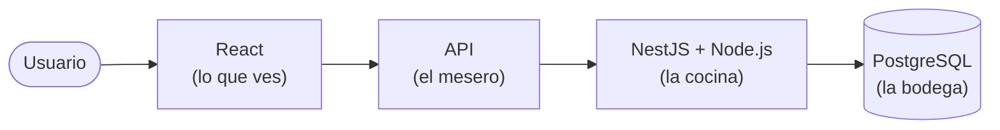

<div align="center">

# Tecnologías de Desarrollo Web: ¿Qué es qué?

**Una guía para quienes apenas empiezan y sienten que todos los nombres suenan igual.**

**Idiomas:** [English](README.md) | Español


</div>

---

React, Next.js, Node.js, NestJS, Vue, Nuxt, Angular, Django... Si sientes que todos son lo mismo, **es completamente normal.** A todos nos pasó.

Esta guía no te va a enseñar a programar. Te va a ayudar a **ubicar cada nombre en el mapa**, para que la próxima vez que lo escuches sepas de qué se trata.

> [!TIP]
> No necesitas aprender todo esto. Ni siquiera la mitad. Solo necesitas saber qué es cada cosa para no sentirte perdido.

## Índice

1. [Lo básico: ¿de qué está hecha una página web?](#1-lo-básico-de-qué-está-hecha-una-página-web)
2. [Las palabras que vas a escuchar mucho](#2-las-palabras-que-vas-a-escuchar-mucho)
3. [¿Qué es cada tecnología?](#3-qué-es-cada-tecnología)
4. [Las confusiones más comunes](#4-las-confusiones-más-comunes)
5. [Un ejemplo real](#5-un-ejemplo-real)
6. [¿Por dónde empiezo?](#6-por-dónde-empiezo)
7. [Para llevar](#7-para-llevar)

---

## 1. Lo básico: ¿de qué está hecha una página web?

Imagina un **restaurante**

| En el restaurante | En una app web | ¿Qué es? |
|---|---|---|
| El comedor, el menú, las mesas | **Frontend** | Lo que ves y tocas: botones, textos, imágenes. |
| La cocina | **Backend** | Donde se procesa todo y tú no lo ves: revisar tu contraseña, calcular un total, etc. |
| El mesero | **API** | El que lleva pedidos del comedor a la cocina y regresa con la respuesta. |
| La bodega | **Base de datos** | Donde se guarda la información: usuarios, productos, pedidos. |

```text
   Tú  →  FRONTEND  →  API  →  BACKEND  →  BASE DE DATOS
         (comedor)  (mesero)  (cocina)      (bodega)
```

Casi todas las tecnologías de esta guía viven en **una** de estas partes. Ese es el truco para entenderlas.

---

## 2. Las palabras que vas a escuchar mucho

| Palabra | En simple | Ejemplo |
|---|---|---|
| **Lenguaje** | El idioma en el que le hablas a la computadora. | JavaScript, Python |
| **Biblioteca** (*library*) | Una caja de herramientas: tú decides cuándo y cómo usarlas. | React |
| **Framework** | Una casa ya con cimientos y paredes: tú la decoras, pero siguiendo sus reglas. | Angular, Django |
| **Runtime** | El lugar donde tu código puede "correr" (ejecutarse). | Node.js |
| **Herramienta** | Ayudantes que hacen tu trabajo más fácil, pero no son tu app. | Vite, npm, Docker |

> [!NOTE]
> Estas categorías no son perfectas y a veces se mezclan. No te preocupes por eso ahorita.

---

## 3. ¿Qué es cada tecnología?

### Frontend (lo que ve el usuario)

| Tecnología | En una frase |
|---|---|
| **React** | La más popular para crear interfaces con piezas reutilizables (llamadas *componentes*). |
| **Vue** | Parecida a React, conocida por ser amigable para principiantes. |
| **Angular** | Más completa y con más reglas. Común en empresas grandes. |
| **Svelte** | Otra alternativa, con una forma de escribir código más corta. |

Las cuatro sirven para **lo mismo**. Normalmente eliges **una**.

### "Versiones con superpoderes"

| Tecnología | En una frase |
|---|---|
| **Next.js** | React + extras (páginas, rutas, algo de backend). |
| **Nuxt** | Lo mismo, pero para Vue. |
| **Astro** | Ideal para blogs, documentación y páginas que deben cargar muy rápido. |

### Backend (la cocina)

| Tecnología | En una frase |
|---|---|
| **Node.js** | Permite usar JavaScript fuera del navegador, por ejemplo en un servidor. **No es un framework.** |
| **Express** | Una forma sencilla y flexible de crear un backend con Node.js. |
| **NestJS** | Una forma más ordenada y estructurada de crear un backend con Node.js. |
| **Django** | Un framework de backend, pero en **Python**. Trae muchas cosas listas. |

### Otras cosas que verás en todos lados

| Tecnología | En una frase |
|---|---|
| **TypeScript** | JavaScript con "reglas extra" que te avisan de errores antes de que pasen. |
| **npm** | Una "tienda" para descargar código que otras personas ya hicieron. |
| **Vite** | Hace que tu proyecto arranque rápido mientras programas. |
| **PostgreSQL** | Una base de datos (la bodega). |
| **Docker** | Empaqueta tu app en una "caja" para que funcione igual en cualquier computadora. |

---

## 4. Las confusiones más comunes

**¿React o Next.js?**
No es uno *o* el otro. Next.js **usa** React por dentro. Si usas Next.js, ya estás usando React.

**¿Vue o Nuxt?**
Igual que arriba: Nuxt **usa** Vue y le agrega extras.

**¿Node.js o NestJS?**
Node.js es el **lugar** donde corre el código. NestJS es una **forma de organizar** tu backend dentro de ese lugar.
Analogía: Node.js es la cocina; NestJS es la receta y el orden con el que trabajas en ella.

**¿Next.js o NestJS?**
Solo se parecen en el nombre
- **Next.js** → principalmente frontend (con React).
- **NestJS** → backend.

Incluso pueden usarse juntos en el mismo proyecto.

---

## 5. Un ejemplo real

Imagina una app para administrar una escuela: ver alumnos, registrar calificaciones y guardarlas.



- **React** muestra las pantallas.
- **NestJS** (corriendo en **Node.js**) procesa las peticiones.
- **PostgreSQL** guarda los datos.

Esta no es la única forma. Podrías usar Django en vez de NestJS, o solo Next.js para todo. **Se elige según lo que necesita el proyecto, no según cuántas tecnologías puedas meter.**

---

## 6. ¿Por dónde empiezo?

Sin importar qué quieras hacer, **empieza por aquí**:

```text
HTML  →  CSS  →  JavaScript
(estructura)  (diseño)  (comportamiento)
```

Después de eso, elige **un** camino:

| Si quieres... | Sigue con... |
|---|---|
| Hacer interfaces bonitas e interactivas | React (o Vue) |
| Hacer el backend con JavaScript | Node.js + Express |
| Hacer el backend con Python | Python + Django |
| Hacer un blog o página informativa | Astro |

> [!IMPORTANT]
> Aprende **una** cosa, haz un proyecto pequeño con ella y después sigue. Saltar de tecnología en tecnología es la forma más rápida de sentirte perdido.

---

## 7. Para llevar

- **No todo es un framework.** Node.js es un runtime, React es una biblioteca, TypeScript es un lenguaje.
- **Nombres parecidos ≠ misma función.** Next.js y NestJS no son lo mismo.
- **Muchas se usan juntas, no compiten.** React y PostgreSQL hacen cosas totalmente distintas.
- **No necesitas aprenderlas todas.** Nadie las sabe todas.

---

## Contribuciones

¿Encontraste un error o algo que podría explicarse más fácil? Abre un [*Issue*](../../issues) o envía un [*Pull Request*](../../pulls). La idea es que esta guía siga siendo simple, no una lista interminable de nombres.

## Licencia

Este proyecto está bajo la [Licencia MIT](LICENSE).

---

<div align="center">

*Guía educativa comunitaria. Las tecnologías cambian, así que esta guía puede actualizarse con el tiempo.*

⭐ Si te ayudó, ¡considera darle una estrella!

</div>
