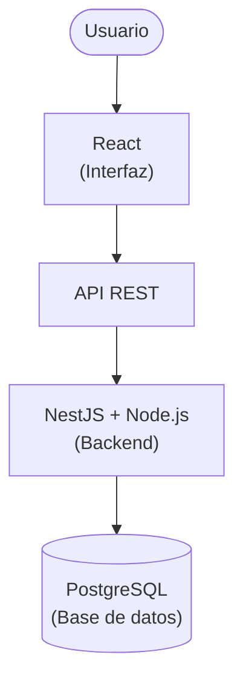

<div align="center">

# Tecnologías de Desarrollo Web: ¿Qué es qué?

**Una guía para principiantes para entender qué es cada tecnología web, qué problema resuelve y cómo se relaciona con las demás.**

[](README.md)
[](README.es.md)


</div>

---

¿React, Next.js, Node.js, NestJS, Nuxt, Vue, Angular, Svelte, Astro o Django? Si todos esos nombres te parecen lo mismo, no eres el único.

El ecosistema del desarrollo web puede ser confuso cuando estás empezando. Hay bibliotecas, frameworks, runtimes y herramientas que tienen nombres parecidos, se complementan entre sí o resuelven problemas similares desde enfoques diferentes.

> [!IMPORTANT]
> **El objetivo de esta guía es ayudarte a entender qué es cada cosa, para qué sirve y cuándo tiene sentido utilizarla.**
>
> No necesitas aprenderlas todas. Primero necesitas entender qué papel cumple cada una.

## Índice

- [1. Antes de empezar: el mapa del ecosistema web](#1-antes-de-empezar-el-mapa-del-ecosistema-web)
- [2. Las tecnologías, por categoría](#2-las-tecnologías-por-categoría)
- [3. Las diferencias que más confunden](#3-las-diferencias-que-más-confunden)
- [4. ¿Cómo se combinan en un proyecto real?](#4-cómo-se-combinan-en-un-proyecto-real)
- [5. ¿Qué tecnología debería aprender?](#5-qué-tecnología-debería-aprender)
- [6. Conceptos clave](#6-conceptos-clave)
- [7. Contribuciones](#7-contribuciones)
- [8. Licencia](#8-licencia)

---

## 1. Antes de empezar: el mapa del ecosistema web

Una aplicación web puede involucrar diferentes piezas. Cada una cumple una función distinta.

```text
                    APLICACIÓN WEB
                          |
             +------------+------------+
             |                         |
          FRONTEND                  BACKEND
      Lo que utiliza el       Lógica y procesamiento
           usuario                    |
             |                  +------+------+
       +-----+------+           |             |
       |            |         API REST     Acceso a
    React        Vue /        o similar    la base de datos
    Angular      Svelte
       |
    Next.js
    (framework de React)

    El frontend también puede comunicarse
    con un backend independiente.
```

> [!NOTE]
> Este esquema es conceptual, no una arquitectura obligatoria. Por ejemplo, Next.js también puede ejecutar lógica del lado del servidor y acceder a datos.

Para entender mejor las tecnologías, primero debemos distinguir algunas categorías:

| Categoría | ¿Qué es? | Ejemplos |
|---|---|---|
| Lenguaje de programación | Permite escribir instrucciones para una computadora. | JavaScript, TypeScript, Python |
| Biblioteca (*library*) | Ofrece funcionalidades que tu código utiliza. | React |
| Framework | Proporciona una estructura y convenciones para desarrollar aplicaciones. | Angular, Django, NestJS |
| Runtime | Proporciona el entorno en el que se ejecuta el código. | Node.js |
| Framework de aplicación (*meta-framework*) | Amplía otra tecnología y ofrece herramientas para construir aplicaciones más completas. | Next.js, Nuxt |
| Herramienta de desarrollo | Facilita tareas como compilar, probar o empaquetar código. | Vite |

Estas categorías no siempre son excluyentes. Por ejemplo, algunos frameworks también se describen como plataformas de desarrollo, y los términos *framework* y *meta-framework* no tienen una frontera universalmente aceptada.

## 2. Las tecnologías, por categoría

### 2.1. Bibliotecas y frameworks de interfaz

Estas tecnologías ayudan a construir la interfaz con la que interactúa el usuario.

| Tecnología | ¿Qué es? | ¿Para qué sirve? |
|---|---|---|
| **React** | Biblioteca de JavaScript para interfaces de usuario. | Construir interfaces mediante componentes reutilizables. |
| **Vue** | Framework progresivo de JavaScript. | Construir interfaces y aplicaciones web con una curva de adopción gradual. |
| **Angular** | Framework de desarrollo web basado en TypeScript. | Construir aplicaciones estructuradas con herramientas y convenciones integradas. |
| **Svelte** | Framework de interfaz que utiliza un compilador para transformar componentes. | Crear interfaces reactivas con una sintaxis propia. |

Aunque cumplen funciones similares, no son idénticos ni tienen exactamente las mismas filosofías de desarrollo.

**Ejemplo:** si quieres construir una tabla de usuarios que se actualice cuando cambien sus datos, puedes utilizar React, Vue, Angular o Svelte.

No necesitas utilizar los cuatro. Normalmente eliges uno para construir la interfaz principal.

### 2.2. Frameworks para aplicaciones web completas

Estas tecnologías amplían las capacidades de otras herramientas y ofrecen soluciones para construir aplicaciones más completas.

| Tecnología | Se basa en | ¿Qué aporta? |
|---|---|---|
| **Next.js** | React | Enrutamiento, renderizado en servidor, generación de páginas y funciones de servidor, entre otras capacidades. |
| **Nuxt** | Vue | Estructura de aplicación, enrutamiento, renderizado en servidor y otras funciones integradas. |
| **Astro** | Arquitectura orientada al contenido | Generación de páginas rápidas y envío de JavaScript al navegador solo cuando se necesita, entre otras opciones. |

Estos frameworks pueden reducir la cantidad de decisiones que debes tomar al comenzar una aplicación.

Sus enfoques también son diferentes: Astro destaca especialmente en sitios orientados al contenido, mientras que Next.js y Nuxt ofrecen herramientas para una variedad más amplia de aplicaciones interactivas.

### 2.3. Backend y ejecución de JavaScript

Aquí aparecen algunos de los nombres que más confunden a quienes están empezando.

| Tecnología | ¿Qué es? | ¿Para qué sirve? |
|---|---|---|
| **Node.js** | Runtime de JavaScript. | Ejecutar JavaScript fuera del navegador, por ejemplo, en un servidor. |
| **NestJS** | Framework de backend que normalmente utiliza Node.js. | Construir servidores y APIs con una arquitectura estructurada. |
| **Express** | Framework web minimalista para Node.js. | Crear servidores, rutas y APIs con flexibilidad. |
| **Django** | Framework web de Python. | Construir aplicaciones y backends con herramientas integradas, como ORM, sistema de autenticación y panel de administración. |

> [!IMPORTANT]
> Node.js **no** es un framework. Es el entorno de ejecución sobre el que pueden funcionar frameworks como NestJS y Express.

Y aunque NestJS y Next.js tienen nombres parecidos, cumplen funciones diferentes:

- Next.js se centra en aplicaciones construidas con React.
- NestJS se centra en el backend y la organización de aplicaciones del servidor.

### 2.4. Herramientas que también encontrarás

No todo lo que aparece en un proyecto es un framework.

| Tecnología | Función |
|---|---|
| **TypeScript** | Añade un sistema de tipos estáticos a JavaScript y se transforma para ejecutarse en los entornos correspondientes. |
| **Vite** | Proporciona herramientas de desarrollo y compilación para proyectos web. |
| **npm** | Gestiona paquetes y dependencias del ecosistema JavaScript. |
| **PostgreSQL** | Sistema de gestión de bases de datos relacionales. |
| **Docker** | Permite empaquetar aplicaciones y sus dependencias en contenedores. |

Estas herramientas pueden utilizarse junto con diferentes frameworks. Por ejemplo, puedes utilizar TypeScript con React, Angular, NestJS o Next.js.

---

## 3. Las diferencias que más confunden

### React vs. Next.js

**React es una biblioteca; Next.js es un framework construido sobre React.**

React proporciona las herramientas principales para construir interfaces mediante componentes. Por sí solo, no impone una solución completa para todas las necesidades de una aplicación.

Next.js incorpora React y ofrece herramientas adicionales para organizar aplicaciones, manejar rutas y utilizar diferentes estrategias de renderizado, entre otras funciones.

Una forma sencilla de recordarlo:

- React: construir interfaces.
- Next.js: construir aplicaciones web basadas en React con una estructura y capacidades adicionales.

No tienes que elegir necesariamente entre ambos: cuando utilizas Next.js, también estás utilizando React.

### Vue vs. Nuxt

La relación es similar a la de React y Next.js.

- Vue es un framework para construir interfaces.
- Nuxt amplía Vue con herramientas para construir aplicaciones web completas.

Nuxt no es una versión independiente de Vue que lo sustituya. Es una forma de trabajar con Vue que proporciona más estructura y funcionalidades.

### Node.js vs. NestJS

Esta diferencia es todavía más importante porque pertenecen a categorías distintas.

- Node.js permite ejecutar JavaScript en el servidor.
- NestJS utiliza un entorno como Node.js y proporciona una estructura para desarrollar aplicaciones backend.

Una analogía: Node.js es el entorno de ejecución; NestJS es una de las herramientas que puedes utilizar para construir tu aplicación dentro de ese entorno.

También puedes utilizar Node.js directamente o con otros frameworks, como Express.

### Next.js vs. NestJS

Aunque sus nombres se parecen, no son alternativas equivalentes.

| | Next.js | NestJS |
|---|---|---|
| Enfoque principal | Aplicaciones web con React. | Aplicaciones backend. |
| Interfaz web | Sí, mediante React. | No proporciona por sí mismo una interfaz web de usuario como React. |
| APIs | Puede implementar endpoints y funciones de servidor. | Es uno de sus usos principales. |
| ¿Pueden coexistir? | Sí. | Sí. |

Por ejemplo, podrías utilizar Next.js para la aplicación web y NestJS para una API independiente. No siempre necesitas separar ambas piezas, pero es una arquitectura posible.

### Angular vs. React

Ambos permiten construir interfaces de usuario, pero no son exactamente el mismo tipo de herramienta.

- React es una biblioteca centrada en interfaces.
- Angular es un framework más integrado que proporciona convenciones y herramientas para organizar aplicaciones.

En términos generales, Angular establece más decisiones desde el inicio, mientras que React permite elegir más piezas por separado. Esto no significa que React carezca de estructura ni que Angular sea siempre mejor para aplicaciones grandes.

### Svelte vs. React

Ambos permiten crear interfaces mediante componentes, pero funcionan de manera diferente.

React se basa en su modelo de componentes y utiliza mecanismos propios para actualizar la interfaz. Svelte transforma los componentes durante la compilación y utiliza su propio modelo de reactividad.

Para un principiante, lo importante es entender que ambos resuelven problemas similares mediante enfoques distintos.

### Astro vs. Next.js

Los dos pueden generar páginas web y ofrecer capacidades de renderizado en servidor, pero tienen prioridades diferentes.

- Astro está especialmente orientado a sitios cuyo contenido debe mostrarse rápidamente, como documentación, blogs y páginas informativas.
- Next.js ofrece una plataforma amplia para aplicaciones basadas en React, incluidas aplicaciones muy interactivas.

No es una regla absoluta: Astro puede incorporar componentes interactivos y Next.js también puede generar páginas estáticas.

### Django vs. Next.js

Compararlos directamente puede ser engañoso porque sus enfoques principales son distintos.

- Django es un framework backend de Python que también permite renderizar páginas HTML en el servidor.
- Next.js es un framework para aplicaciones basadas en React que combina capacidades del lado del cliente y del servidor.

Pueden resolver necesidades que se solapan, pero también pueden formar parte de una misma arquitectura si existe una razón para utilizar ambos.

---

## 4. ¿Cómo se combinan en un proyecto real?

Imagina que quieres construir una aplicación para administrar una escuela.

Necesitas mostrar alumnos, registrar calificaciones, consultar información y guardar los cambios en una base de datos.

Una posible arquitectura sería:



En esta arquitectura:

- React muestra las pantallas y permite interactuar con ellas.
- NestJS organiza la lógica del servidor y expone una API.
- Node.js ejecuta el backend.
- PostgreSQL almacena la información.

También podrías utilizar Next.js en lugar de React con una configuración independiente, o desarrollar el backend con Django en Python.

Otra posibilidad sería construir una aplicación con Next.js que maneje tanto la interfaz como ciertas funciones del servidor, sin necesitar NestJS.

> [!TIP]
> **La clave es que las tecnologías se eligen según las necesidades de la aplicación, no por la cantidad de frameworks que puedas incluir.**

---

## 5. ¿Qué tecnología debería aprender?

No existe una respuesta universal. Depende de qué quieras construir y qué conocimientos tengas.

| Si tu objetivo es... | Podrías comenzar por... |
|---|---|
| Aprender a construir interfaces web. | HTML, CSS, JavaScript y después React, Vue o Angular. |
| Construir una aplicación basada en React con más herramientas integradas. | React y después Next.js. |
| Crear APIs y servicios backend con JavaScript. | JavaScript, Node.js y después Express o NestJS. |
| Construir aplicaciones backend con Python. | Python y después Django. |
| Crear un sitio centrado en contenido y páginas rápidas. | HTML, CSS y Astro. |

No necesitas aprender todas las tecnologías de una categoría.

Una ruta razonable consiste en aprender primero los fundamentos, elegir una herramienta para tu objetivo y construir proyectos reales antes de añadir más tecnologías.

---

## 6. Conceptos clave

Antes de terminar, recuerda estas ideas:

- **No todo es un framework.** Node.js es un runtime, React es una biblioteca y TypeScript es un lenguaje.
- **Los nombres parecidos no significan funciones iguales.** Next.js y NestJS no son equivalentes.
- **Una tecnología puede depender de otra.** Next.js utiliza React; NestJS normalmente se ejecuta sobre Node.js.
- **No todas las tecnologías compiten.** React y PostgreSQL cumplen funciones completamente diferentes.
- **Puedes combinar tecnologías.** Un proyecto puede tener una interfaz, una API, una base de datos y herramientas de infraestructura distintas.
- **Más tecnologías no significa una mejor aplicación.** La elección depende del problema, los requisitos y la experiencia del equipo.

## 7. Contribuciones

Esta guía está pensada para estudiantes y personas que están comenzando en el desarrollo web.

Si encuentras un error, consideras que una explicación puede ser más clara o quieres proponer una tecnología que debería incluirse, las contribuciones son bienvenidas.

Puedes abrir un [*Issue*](../../issues) para proponer cambios o enviar un [*Pull Request*](../../pulls) con una mejora.

> **La meta no es enumerar todas las tecnologías existentes, sino ayudar a entender el ecosistema web sin convertirlo en una lista interminable de nombres.**

## 8. Licencia

Este proyecto está bajo la [Licencia MIT](LICENSE).

---

<div align="center">

*Guía educativa comunitaria. Las tecnologías evolucionan, por lo que las explicaciones pueden actualizarse con el tiempo.*

⭐ Si esta guía te ayudó, ¡considera darle una estrella!

</div>
