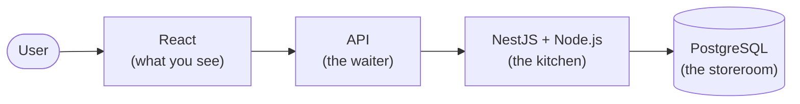

<div align="center">

# Web Development Technologies: What Is What?

**A guide for people who are just starting out and feel like every name sounds the same.**

**Languages:** English | [Español](README.es.md)


</div>

---

React, Next.js, Node.js, NestJS, Vue, Nuxt, Angular, Django... If they all sound like the same thing to you, **that's completely normal.** It happened to all of us.

This guide won't teach you how to code. It will help you **place each name on the map**, so the next time you hear it, you'll know what it's about.

> [!TIP]
> You don't need to learn all of this. Not even half of it. You just need to know what each thing is so you don't feel lost.

## Table of Contents

1. [The basics: what is a website made of?](#1-the-basics-what-is-a-website-made-of)
2. [Words you'll hear a lot](#2-words-youll-hear-a-lot)
3. [What is each technology?](#3-what-is-each-technology)
4. [The most common mix-ups](#4-the-most-common-mix-ups)
5. [A real example](#5-a-real-example)
6. [Where do I start?](#6-where-do-i-start)
7. [Takeaways](#7-takeaways)

---

## 1. The basics: what is a website made of?

Picture a **restaurant**

| In the restaurant | In a web app | What is it? |
|---|---|---|
| The dining room, menu, and tables | **Frontend** | What you see and touch: buttons, text, images. |
| The kitchen | **Backend** | Where everything gets processed out of sight: checking your password, calculating a total, etc. |
| The waiter | **API** | Carries orders from the dining room to the kitchen and comes back with the answer. |
| The storeroom | **Database** | Where information is kept: users, products, orders. |

```text
   You  →  FRONTEND  →   API   →  BACKEND  →  DATABASE
          (dining room) (waiter)  (kitchen)   (storeroom)
```

Almost every technology in this guide lives in **one** of these parts. That's the trick to understanding them.

---

## 2. Words you'll hear a lot

| Word | In plain terms | Example |
|---|---|---|
| **Language** | The language you use to talk to the computer. | JavaScript, Python |
| **Library** | A toolbox: you decide when and how to use the tools. | React |
| **Framework** | A house that already has a foundation and walls: you decorate it, but you follow its rules. | Angular, Django |
| **Runtime** | The place where your code can "run" (execute). | Node.js |
| **Tool** | Helpers that make your work easier, but aren't your app. | Vite, npm, Docker |

> [!NOTE]
> These categories aren't perfect and sometimes overlap. Don't worry about that for now.

---

## 3. What is each technology?

### Frontend (what the user sees)

| Technology | In one sentence |
|---|---|
| **React** | The most popular way to build interfaces out of reusable pieces (called *components*). |
| **Vue** | Similar to React, known for being beginner-friendly. |
| **Angular** | More complete and with more rules. Common in large companies. |
| **Svelte** | Another alternative, with a shorter way of writing code. |

All four do **the same job**. You usually pick **one**.

### "Versions with superpowers"

| Technology | In one sentence |
|---|---|
| **Next.js** | React + extras (pages, routes, some backend). |
| **Nuxt** | The same idea, but for Vue. |
| **Astro** | Great for blogs, documentation, and pages that need to load very fast. |

### Backend (the kitchen)

| Technology | In one sentence |
|---|---|
| **Node.js** | Lets you use JavaScript outside the browser, for example on a server. **It's not a framework.** |
| **Express** | A simple, flexible way to build a backend with Node.js. |
| **NestJS** | A more organized, structured way to build a backend with Node.js. |
| **Django** | A backend framework, but in **Python**. Comes with a lot built in. |

### Other things you'll see everywhere

| Technology | In one sentence |
|---|---|
| **TypeScript** | JavaScript with "extra rules" that warn you about mistakes before they happen. |
| **npm** | A "store" for downloading code other people already wrote. |
| **Vite** | Makes your project start up fast while you code. |
| **PostgreSQL** | A database (the storeroom). |
| **Docker** | Packs your app into a "box" so it works the same on any computer. |

---

## 4. The most common mix-ups

**React or Next.js?**
It's not one *or* the other. Next.js **uses** React under the hood. If you use Next.js, you're already using React.

**Vue or Nuxt?**
Same as above: Nuxt **uses** Vue and adds extras.

**Node.js or NestJS?**
Node.js is the **place** where the code runs. NestJS is a **way to organize** your backend inside that place.
Analogy: Node.js is the kitchen; NestJS is the recipe and the order you follow while working in it.

**Next.js or NestJS?**
They only look alike in name
- **Next.js** → mainly frontend (with React).
- **NestJS** → backend.

They can even be used together in the same project.

---

## 5. A real example

Imagine an app to manage a school: view students, record grades, and save them.



- **React** shows the screens.
- **NestJS** (running on **Node.js**) handles the requests.
- **PostgreSQL** stores the data.

This isn't the only way. You could use Django instead of NestJS, or just Next.js for everything. **You choose based on what the project needs, not on how many technologies you can fit in.**

---

## 6. Where do I start?

No matter what you want to build, **start here**:

```text
HTML   →   CSS   →   JavaScript
(structure)  (design)  (behavior)
```

After that, pick **one** path:

| If you want to... | Continue with... |
|---|---|
| Build nice, interactive interfaces | React (or Vue) |
| Build the backend with JavaScript | Node.js + Express |
| Build the backend with Python | Python + Django |
| Build a blog or informational site | Astro |

> [!IMPORTANT]
> Learn **one** thing, build a small project with it, and then move on. Jumping from technology to technology is the fastest way to feel lost.

---

## 7. Takeaways

- **Not everything is a framework.** Node.js is a runtime, React is a library, TypeScript is a language.
- **Similar names ≠ same job.** Next.js and NestJS are not the same thing.
- **Many are used together; they don't compete.** React and PostgreSQL do completely different things.
- **You don't need to learn them all.** Nobody knows them all.

---

## Contributing

Found a mistake or something that could be explained more simply? Open an [Issue](../../issues) or submit a [Pull Request](../../pulls). The goal is to keep this guide simple, not to turn it into an endless list of names.

## License

This project is licensed under the [MIT License](LICENSE).

---

<div align="center">

*Community educational guide. Technologies change, so this guide may be updated over time.*

⭐ If it helped you, consider giving it a star!

</div>
