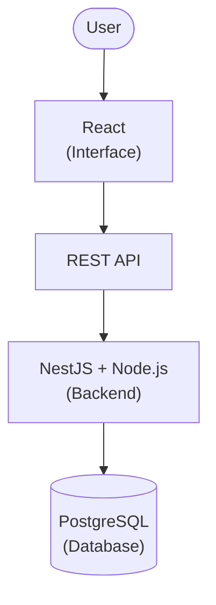

<div align="center">

# Web Development Technologies: What Is What?

**A beginner-friendly guide to understanding what each web technology is, what problem it solves, and how it relates to the others.**

🌐 **Languages:** 🇺🇸 English | 🇪🇸 [Español](README.es.md)


</div>

---

React, Next.js, Node.js, NestJS, Nuxt, Vue, Angular, Svelte, Astro or Django? If all of those names look like the same thing to you, you're not alone.

The web development ecosystem can be confusing when you're just starting out. There are libraries, frameworks, runtimes, and tools with similar names that complement each other or solve similar problems from different angles.

> [!IMPORTANT]
> **The goal of this guide is to help you understand what each thing is, what it's for, and when it makes sense to use it.**
>
> You don't need to learn them all. First, you need to understand the role each one plays.

## Table of Contents

- [1. Before you start: the web ecosystem map](#1-before-you-start-the-web-ecosystem-map)
- [2. The technologies, by category](#2-the-technologies-by-category)
- [3. The differences that confuse people the most](#3-the-differences-that-confuse-people-the-most)
- [4. How do they fit together in a real project?](#4-how-do-they-fit-together-in-a-real-project)
- [5. Which technology should I learn?](#5-which-technology-should-i-learn)
- [6. Key takeaways](#6-key-takeaways)
- [7. Contributing](#7-contributing)
- [8. License](#8-license)

---

## 1. Before you start: the web ecosystem map

A web application can involve several pieces. Each one has a different job.

```text
                      WEB APPLICATION
                            |
               +------------+------------+
               |                         |
            FRONTEND                  BACKEND
        What the user sees        Logic and processing
         and interacts with              |
               |                  +------+------+
         +-----+------+           |             |
         |            |        REST API      Database
      React        Vue /        or similar     access
      Angular      Svelte
         |
      Next.js
   (React framework)

   The frontend can also talk to a
   separate, independent backend.
```

> [!NOTE]
> This diagram is conceptual, not a mandatory architecture. For example, Next.js can also run server-side logic and access data.

To understand the technologies better, we first need to tell some categories apart:

| Category | What is it? | Examples |
|---|---|---|
| Programming language | Lets you write instructions for a computer. | JavaScript, TypeScript, Python |
| Library | Offers functionality that your code uses. | React |
| Framework | Provides structure and conventions for building applications. | Angular, Django, NestJS |
| Runtime | Provides the environment where code runs. | Node.js |
| Application framework (*meta-framework*) | Extends another technology and offers tools for building more complete applications. | Next.js, Nuxt |
| Development tool | Makes tasks like building, testing, or bundling code easier. | Vite |

These categories aren't always mutually exclusive. For example, some frameworks are also described as development platforms, and the terms *framework* and *meta-framework* don't have a universally accepted boundary.

## 2. The technologies, by category

### 2.1. UI libraries and frameworks

These technologies help you build the interface users interact with.

| Technology | What is it? | What is it for? |
|---|---|---|
| **React** | JavaScript library for user interfaces. | Building interfaces with reusable components. |
| **Vue** | Progressive JavaScript framework. | Building interfaces and web apps with a gradual adoption curve. |
| **Angular** | TypeScript-based web development framework. | Building structured applications with built-in tools and conventions. |
| **Svelte** | UI framework that uses a compiler to transform components. | Creating reactive interfaces with its own syntax. |

Although they serve similar purposes, they aren't identical and don't share exactly the same development philosophies.

**Example:** if you want to build a users table that updates when the data changes, you can use React, Vue, Angular, or Svelte.

You don't need to use all four. You normally pick one to build your main interface.

### 2.2. Frameworks for full web applications

These technologies extend the capabilities of other tools and offer solutions for building more complete applications.

| Technology | Built on | What does it bring? |
|---|---|---|
| **Next.js** | React | Routing, server-side rendering, page generation, and server functions, among other capabilities. |
| **Nuxt** | Vue | Application structure, routing, server-side rendering, and other built-in features. |
| **Astro** | Content-focused architecture | Fast page generation and shipping JavaScript to the browser only when needed, among other options. |

These frameworks can reduce the number of decisions you have to make when starting an application.

Their approaches are also different: Astro shines especially in content-focused sites, while Next.js and Nuxt offer tools for a wider variety of interactive applications.

### 2.3. Backend and JavaScript execution

This is where some of the names that confuse beginners the most show up.

| Technology | What is it? | What is it for? |
|---|---|---|
| **Node.js** | JavaScript runtime. | Running JavaScript outside the browser, for example on a server. |
| **NestJS** | Backend framework that normally uses Node.js. | Building servers and APIs with a structured architecture. |
| **Express** | Minimalist web framework for Node.js. | Creating servers, routes, and APIs with flexibility. |
| **Django** | Python web framework. | Building applications and backends with built-in tools such as an ORM, an authentication system, and an admin panel. |

> [!IMPORTANT]
> Node.js is **not** a framework. It's the runtime environment on which frameworks like NestJS and Express can run.

And although NestJS and Next.js have similar names, they serve different purposes:

- Next.js focuses on applications built with React.
- NestJS focuses on the backend and on organizing server-side applications.

### 2.4. Tools you'll also come across

Not everything that shows up in a project is a framework.

| Technology | Role |
|---|---|
| **TypeScript** | Adds a static type system to JavaScript and is transformed to run in the corresponding environments. |
| **Vite** | Provides development and build tooling for web projects. |
| **npm** | Manages packages and dependencies in the JavaScript ecosystem. |
| **PostgreSQL** | Relational database management system. |
| **Docker** | Lets you package applications and their dependencies into containers. |

These tools can be used alongside different frameworks. For example, you can use TypeScript with React, Angular, NestJS, or Next.js.

---

## 3. The differences that confuse people the most

### React vs. Next.js

**React is a library; Next.js is a framework built on top of React.**

React provides the core tools for building interfaces with components. On its own, it doesn't impose a complete solution for every need of an application.

Next.js includes React and adds tools to organize applications, handle routes, and use different rendering strategies, among other features.

A simple way to remember it:

- React: building interfaces.
- Next.js: building React-based web applications with extra structure and capabilities.

You don't necessarily have to choose between the two: when you use Next.js, you're also using React.

### Vue vs. Nuxt

The relationship is similar to React and Next.js.

- Vue is a framework for building interfaces.
- Nuxt extends Vue with tools for building full web applications.

Nuxt isn't a standalone version of Vue that replaces it. It's a way of working with Vue that provides more structure and features.

### Node.js vs. NestJS

This difference is even more important because they belong to different categories.

- Node.js lets you run JavaScript on the server.
- NestJS uses an environment like Node.js and provides a structure for developing backend applications.

An analogy: Node.js is the runtime environment; NestJS is one of the tools you can use to build your application inside that environment.

You can also use Node.js directly or with other frameworks, such as Express.

### Next.js vs. NestJS

Although their names are similar, they aren't equivalent alternatives.

| | Next.js | NestJS |
|---|---|---|
| Main focus | Web applications with React. | Backend applications. |
| Web interface | Yes, through React. | Doesn't provide a user interface on its own the way React does. |
| APIs | Can implement endpoints and server functions. | One of its main use cases. |
| Can they coexist? | Yes. | Yes. |

For example, you could use Next.js for the web application and NestJS for a separate API. You don't always need to split both pieces, but it's a possible architecture.

### Angular vs. React

Both let you build user interfaces, but they aren't exactly the same kind of tool.

- React is a library focused on interfaces.
- Angular is a more integrated framework that provides conventions and tools to organize applications.

Broadly speaking, Angular makes more decisions up front, while React lets you choose more pieces separately. That doesn't mean React lacks structure, nor that Angular is always better for large applications.

### Svelte vs. React

Both let you build interfaces with components, but they work differently.

React relies on its own component model and uses its own mechanisms to update the interface. Svelte transforms components at build time and uses its own reactivity model.

For a beginner, the important takeaway is that both solve similar problems with different approaches.

### Astro vs. Next.js

Both can generate web pages and offer server-side rendering, but they have different priorities.

- Astro is especially geared toward sites whose content needs to display quickly, such as documentation, blogs, and informational pages.
- Next.js offers a broad platform for React-based applications, including highly interactive ones.

It's not an absolute rule: Astro can include interactive components, and Next.js can also generate static pages.

### Django vs. Next.js

Comparing them directly can be misleading because their main approaches are different.

- Django is a Python backend framework that can also render HTML pages on the server.
- Next.js is a framework for React-based applications that combines client-side and server-side capabilities.

They can solve overlapping needs, but they can also be part of the same architecture if there's a reason to use both.

---

## 4. How do they fit together in a real project?

Imagine you want to build an application to manage a school.

You need to display students, record grades, look up information, and save changes to a database.

One possible architecture:



In this architecture:

- React displays the screens and lets users interact with them.
- NestJS organizes the server logic and exposes an API.
- Node.js runs the backend.
- PostgreSQL stores the data.

You could also use Next.js instead of React with a separate setup, or build the backend with Django in Python.

Another possibility would be to build an application with Next.js that handles both the interface and certain server functions, without needing NestJS.

> [!TIP]
> **The key is that technologies are chosen based on the needs of the application, not on how many frameworks you can fit in.**

---

## 5. Which technology should I learn?

There's no universal answer. It depends on what you want to build and what you already know.

| If your goal is... | You could start with... |
|---|---|
| Learning to build web interfaces. | HTML, CSS, JavaScript, and then React, Vue, or Angular. |
| Building a React-based application with more built-in tools. | React and then Next.js. |
| Creating APIs and backend services with JavaScript. | JavaScript, Node.js, and then Express or NestJS. |
| Building backend applications with Python. | Python and then Django. |
| Creating a content-focused site with fast pages. | HTML, CSS, and Astro. |

You don't need to learn every technology in a category.

A reasonable path is to learn the fundamentals first, pick one tool for your goal, and build real projects before adding more technologies.

---

## 6. Key takeaways

Before you go, remember these ideas:

- **Not everything is a framework.** Node.js is a runtime, React is a library, and TypeScript is a language.
- **Similar names don't mean the same function.** Next.js and NestJS are not equivalent.
- **One technology can depend on another.** Next.js uses React; NestJS normally runs on top of Node.js.
- **Not all technologies compete.** React and PostgreSQL play completely different roles.
- **You can combine technologies.** A project can have a separate interface, API, database, and infrastructure tooling.
- **More technologies doesn't mean a better application.** The choice depends on the problem, the requirements, and the team's experience.

## 7. Contributing

This guide is meant for students and people who are just getting started in web development.

If you find a mistake, think an explanation could be clearer, or want to suggest a technology that should be included, contributions are welcome.

You can open an [Issue](../../issues) to propose changes or submit a [Pull Request](../../pulls) with an improvement.

> **The goal isn't to list every technology that exists, but to help people understand the web ecosystem without turning it into an endless list of names.**

## 8. License

This project is licensed under the [MIT License](LICENSE).

---

<div align="center">

*Community educational guide. Technologies evolve, so the explanations may be updated over time.*

⭐ If this guide helped you, consider giving it a star!

</div>
